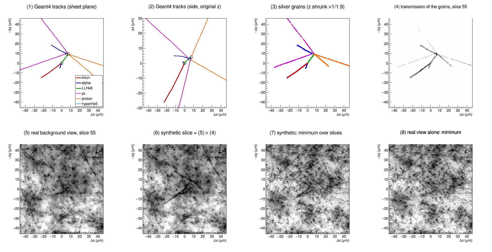

# e07-g4-hypernuclei

Geant4 track simulation of double-strangeness events in the J-PARC E07
nuclear emulsion: Xi- capture at rest on the light emulsion nuclei 12C,
14N, 16O, followed by the weak decays of the produced hypernuclei.

## Quick start

Everything is driven by `./run.py` (`./run.py --help`, `./run.py <command>
--help`). Requires Python 3 with numpy and PyROOT, ROOT (tested with
6.40) and Geant4 (tested with 11.4.3; `GEANT4_DIR`, default
`~/software/geant4/11.4.3`).

```
./run.py setup                       # tables + Geant4 build
./run.py sim --preset nagara --events 100
./run.py draw data/sim/nagara.root --event 0 -o ev0.png
./run.py summary data/sim/nagara.root -o summary.png
./run.py check-range data/sim/nagara.root
```

| Command | Module | Output |
|---------|--------|--------|
| `channels` | `module/enumerate_channels.py` | `output/channels_*.csv`, `species.csv`, `targets.csv` |
| `decays` | `module/enumerate_decays.py` | `output/decays.csv` |
| `build` | `module/build.py` | `g4/build/emulsim` |
| `sim` | `module/simulate.py` | `data/sim/<name>.{mac,log,root}` |
| `draw` | `module/draw_event.py` | event display PNG |
| `summary` | `module/summary.py` | containment summary PNG |
| `check-range` | `module/check_range.py` | range comparison with kinema |
| `replay` | `module/replay.py` | `output/replay/{nagara,ibuki}.csv` fixed kinematics |
| `images` | `module/synth/` | `data/images/<name>/ev<NNNN>/` microscope stacks |
| `compare` | `module/imagestats.py` | image statistics of real vs synthetic stacks |
| `calibrate` | `module/synth/calibrate.py` | `output/image_model.json` tuned image model |
| `flatfield` | `module/synth/flatfield.py` | `output/flatfield.npy` illumination profile |
| `validate` | `module/synth/validate.py` | `output/realism.md` realism on held-out real views |
| `efficiency` | `module/efficiency.py` | vertex-finding efficiency vs truth |
| `pipelinefig` | `module/pipelinefig.py` | Geant4 tracks -> grains -> image figure |
| `setup` | | `channels` + `decays` + `build` |

Layout: `module/` Python package, `g4/` Geant4 application (C++),
`output/` tables (tracked), `data/` generated files (not tracked).

## Channel enumeration

```
./run.py channels [--measured-only] [--max-bodies N]
```

Conservation laws: baryon number A+1, charge Z-1, two Lambdas
(S = -2). Every multiset of particle-stable species satisfying them with

    Q = M(A) + M(Xi-) - B_Xi - sum M_f > 0

is listed (up to `--max-bodies`, default 6).

### Inputs (`module/species.py`)

| Item | Source / assumption |
|------|---------------------|
| Nuclear masses | AME2020 mass excess (unbound 5He, 5Li, 6Be, 7He, 8Be, 9B used only as hypernuclear cores) |
| B_Lambda | Emulsion compilation (Juric 1973 / Davis 2005); 7He_L and 16N_L from JLab |
| B_Xi | Atomic 3D state: 0.126 (C), 0.174 (N), 0.231 (O) MeV (`TARGETS`) |
| Unmeasured B_Lambda | Isobar mean of measured B_Lambda, interpolated in A (flagged `estimated`) |
| B_LambdaLambda | Measured: 6He_LL = 6.91 MeV (Nagara). Others: 2 B_Lambda(A-1) + 0.67 MeV (flagged) |

Hypernuclei (measured or estimated) are kept only if they are stable
against any strong breakup into lighter species of the database (e.g.
6Li_L is rejected because 6Li_L -> 5He_L + p is open).

### Outputs (`output/`)

- `species.csv`: particle-stable species with masses.
- `channels_<target>.csv`: one row per channel with columns
  `category` (`double`, `twin`, `single+L`, `free-LL`), `channel`,
  `q_mev`, `n_bodies`, `n_charged`, `n_neutral`, `p_2body_mev`
  (CM momentum for two-body states), `uses_estimate`.

A single-body final state (e.g. `LL13B + gamma`) means compound formation
followed by radiative de-excitation.

`output/targets.csv` holds the initial mass M(A) + M(Xi-) - B_Xi used by
the Geant4 generator.

### Limitations

- Only ground states; excited hypernuclei / fragments (e.g. 12Be_LL*)
  shift Q by their excitation energy and are not listed separately.
- Estimated B_Lambda and B_LambdaLambda carry ~1 MeV uncertainties;
  channels with small Q and `uses_estimate = 1` may be closed.
- Xi hypernucleus formation is not included.

## Weak-decay enumeration

```
./run.py decays [--measured-only] [--max-bodies N]
```

For every hypernucleus in `species.csv` one Lambda decays at a time:

| Mode | Process | Products (A, Z, nL) |
|------|---------|---------------------|
| `pi-` | Lambda -> p pi- | (A, Z+1, nL-1) + pi- |
| `pi0` | Lambda -> n pi0 | (A, Z, nL-1) + pi0 |
| `nm` | Lambda N -> N N, Lambda Lambda -> Lambda N | (A, Z, nL-1), >= 2 bodies |

All partitions into particle-stable species with Q > 0 are written to
`output/decays.csv` (`parent`, `mode`, `channel`, `q_mev`, `n_bodies`,
`n_charged`, `uses_estimate`), up to `--max-bodies` (default 4,
including the pion). Double-Lambda hypernuclei decay into single-Lambda
hypernuclei (or a free Lambda), which decay in turn.

## Geant4 track simulation (`g4/`)

`emulsim` generates one channel of Xi- capture at rest with
`TGenPhaseSpace` (isotropic, unweighted n-body phase space, masses from
`output/species.csv` / `output/targets.csv`) at a random point in the
emulsion layers of an E07 emulsion module and tracks the products.
Stopped
hypernuclei decay at rest into a channel of `output/decays.csv`, again
with phase-space kinematics, so that chains such as
LL6He -> L5He + p + pi-, L5He -> 4He + p + pi- are followed.

### Running

`./run.py sim` writes a macro to `data/sim/<name>.mac` and runs emulsim
with the Geant4 environment:

```
./run.py sim --preset nagara --events 1000      # 12C -> LL6He + 4He + t
./run.py sim --preset ibuki                      # 14N -> L10Be + L5He
./run.py sim --target 16O --channel LL13B,4He --policy uniform \
  --name o16_ll13b --events 100
./run.py sim --preset nagara --fix LL6He=L5He,p,pi- \
  --set "/emul/thickEmulsion 530 um"
```

Presets `nagara_replay` and `ibuki_replay` reproduce the observed events
with their measured kinematics (see below).

`--set` passes any macro command below (`/emul/*` are placed before
`/run/initialize` automatically).

Macro commands:

| Command | Default | Meaning |
|---------|---------|---------|
| `/emul/density` | 3.53 | Emulsion density (g/cm3) |
| `/emul/sheetX`, `/emul/sheetY` | 345 mm, 350 mm | Sheet area |
| `/emul/thickEmulsion`, `/emul/thickBase` | 450 um, 40 um | Thick sheet: emulsion (per side), base |
| `/emul/thinEmulsion`, `/emul/thinBase` | 100 um, 180 um | Thin sheet: emulsion (per side), base |
| `/emul/numThick` | 11 | Number of thick sheets |
| `/emul/numThinUp`, `/emul/numThinDown` | 1, 1 | Thin sheets upstream / downstream |
| `/emul/minStep`, `/emul/maxStep` | 0.1 um, 10 um | Bounds of the step limit |
| `/emul/rangeFraction` | 0.01 | Step limit / estimated residual range |
| `/xi/speciesFile`, `/xi/targetsFile`, `/xi/decaysFile` | `../../output/*.csv` | Tables |
| `/xi/target` | `12C` | `12C`, `14N` or `16O` |
| `/xi/channel` | `LL6He,4He,t` | Products, comma separated, names as in `species.csv` |
| `/xi/replayFile` | | Fixed momenta of the capture and of hypernuclear decays (overrides `/xi/channel` and the decay policy for the listed parents) |
| `/xi/seed` | 12345 | Seed of `gRandom` (TGenPhaseSpace) |
| `/xi/vertexMode` | `random` | `random`: uniform in the thick emulsion layers; `fixed`: `/xi/vertex` |
| `/xi/vertex` | 0 0 0 um | Capture point for the fixed mode |
| `/decay/policy` | `simple` | Choice of the decay channel (see below) |
| `/decay/channel <parent> <products>` | | Fix the channel of one parent, e.g. `LL6He L5He,p,pi-` |
| `/out/file` | `emulsim.root` | Output file |

`/emul/*` must precede `/run/initialize`. The generator checks
conservation of A, Z and S and that Q > 0.

Decay policies (branching ratios are **not** physical):

- `simple`: the pi- mode with the fewest bodies, highest Q among them
  (falls back to all modes if no pi- mode is open).
- `uniform`: any channel of `decays.csv` with equal probability.
- `uniformPiMinus`: any pi- channel with equal probability.

### Geometry

One E07 emulsion module (nominal thicknesses before development): thin
sheet + 11 thick sheets + thin sheet stacked along the beam axis z
without gaps, each sheet being emulsion | polystyrene base | emulsion,
area 345 x 350 mm2, total thickness 11.1 mm, centered at the origin
inside an air world. The thin-sheet thicknesses and the emulsion
thickness at exposure (the measured sheet thickness of about 1.1 mm in
kinema suggests ~530 um per side) should be confirmed.

A track that leaves the module is flagged (`escaped`) and killed.

### Physics

- FTFP_BERT with `G4EmStandardPhysics_option4`, production cut 1 um,
  `G4StepLimiterPhysics`. The step limit of charged particles is
  `rangeFraction` times a Bragg-Kleeman estimate of the residual range,
  clamped to [`minStep`, `maxStep`], so short tracks and track ends are
  sampled finely.
- Hypernuclei are `G4IonTable::GetIon(Z, A, nL)` ions; their dynamic mass
  is that of `species.csv`. `HypernucleusDecayPhysics` adds the at-rest
  process `HypernucleusDecay` to GenericIon and to the light hypernuclei
  predefined by Geant4 (hypertriton, hyperHe5, ...), whose own `Decay`
  is removed and which are given ion EM processes. Decays in flight are
  neglected (c tau ~ 8 cm vs. ranges of um).
- pi- stop and are absorbed by Bertini (sigma stars); free Lambdas decay
  via `G4Decay`.
- Emulsion: AgBr + gelatin with approximate mass fractions
  (`DetectorConstruction.cc`).

### Output (`tree`)

One entry per event with the capture point `vx/vy/vz` (um) and
`contained` (no charged capture or hypernuclear decay product left the
module). All tracks except e+-, gamma and neutrinos are stored as
vectors: `id`, `parent` (0 for capture products), `process` (creator:
`primary`, `HypernucleusDecay`, `hBertiniCaptureAtRest`, ...), `name`,
`z`, `a`, `nl`, `escaped`, `ke` (MeV), `px/py/pz` (MeV/c), `range`
(start-to-end distance, um), `length` (path length, um), step points
`x/y/zpos` (um) and `edep` (MeV). About 0.11 MB per event for
nagara.mac.

The tree `layers` lists the module layers (`sheet`, `emulsion`, `thick`,
`zmin`, `zmax`, `halfx`, `halfy` in um).

### Plots and checks

- `./run.py draw file.root --event N [--zoom 40] [--neutral]
  -o ev.png`: event display relative to the capture point; top row
  +-zoom um, bottom row the whole capture / decay chain; columns XY
  (sheet plane), ZX, ZY with base films shaded and the outside of the
  module hatched. Capture products thick, decay products medium, other
  secondaries thin; escaping tracks end with an open circle.
- `./run.py summary file.root -o summary.png`: capture-point depth
  of all / contained events and escape fraction per particle.
- `./run.py check-range file.root [--kinema <dir>] [--density 3.53]`
  (`KINEMA_DIR`, default `~/work/kinema`): compares Geant4 ranges of the capture products with
  the kinema range-energy relation (`rangeenergy.py`) and checks
  energy-momentum conservation.

With the default emulsion model the Geant4 ranges of t and alpha are
about 5 % shorter than the kinema relation at the same density; the
density / composition should be calibrated (e.g. with 8.78 MeV alpha
from ThC') before quantitative use.

## Observed events with measured kinematics (`./run.py replay`)

`module/replay.py` converts the measured ranges and angles of Nagara
(kinema `runcard.json`, NagaraA/B/C, density 3.629) and Ibuki (kinema
`input/twin_mod047pl10/e07twin_mod047pl10_{A,B,C}.json`, density 3.605)
into momentum vectors with the kinema range-energy relation, and writes
`output/replay/<event>.csv` (vertex, name, px, py, pz). The capture
products and the listed hypernuclear decays are then generated with
exactly these momenta (`./run.py sim --preset nagara_replay`); the
capture point and the background are random as usual.

| Vertex | Nagara | Ibuki |
|--------|--------|-------|
| A (capture) | LL6He + 4He + t | L10Be + L5He |
| B | LL6He -> L5He + p + pi- (pi- energy from Q) | L10Be -> d + t + t + p + n (kinema best candidate, not unique) |
| C | L5He -> d + p + n + n (only balancing 2-prong channel) | L5He -> 4He + pi- + p |

Missing neutrons take the missing momentum (one) or share the missing
four-momentum isotropically (two, `--seed`). The Geant4 ranges of the
short tracks reproduce the measured ones within a few percent (e.g.
Nagara t 88.3 / 88.3 um, Ibuki L10Be 9.2 / 9.17 um); long p and pi-
tracks may end earlier by interactions or by leaving the module.

## Synthetic microscope images (`./run.py images`)

```
./run.py images data/sim/nagara.root --events 0-99 -j 20 --name nagara_dz3.0
./run.py images data/sim/nagara.root --events 0-99 -j 20 --dz 1.5 \
  --name nagara_dz1.5
```

From Geant4 tracks to a microscope image, for event 0 of
`v20_embed_nagara_dz4` (12C -> LL6He + 4He + t; LL6He -> 5LHe + p + pi-;
5LHe -> 4He + p + pi-) embedded into a real eval view:



(1), (2) Geant4 steps of the charged tracks around the capture point
(circles: capture and the two weak-decay vertices; the 2.3 um 5LHe is
barely visible). (3) Silver grains developed along the tracks, with the
emulsion depth shrunk by 1.9. (4) Their transmission in the slice in
focus at the capture point, including the blurred grains of the
neighbouring depths. (5) The same slice of the real background view and
(6) the synthetic slice = real x transmission. (7) The minimum projection
of the whole synthetic stack, compared with (8) the real view alone:
the event, clear in its own slice, is hard to pick out of the projection
of the dark background. Made with

```
./run.py pipelinefig data/images/v20_embed_nagara_dz4/ev0000 \
  --root data/sim/eval_nagara.root --model output/signal_model_v20.json \
  -o docs/pipeline_ev0000.png
```

(needs a real background without `--bg-augment`; the transmission is
recomputed from `grains.npz` with the given model).

Each simulated event becomes one view of the E07 full scan
(`module/synth/render.py` holds all model parameters):

- Geometry: 2048 x 2048 px at 0.289 um/px, 60 slices. `--dz` is the
  physical focal step per slice in the developed emulsion (default 3.0
  um; 1.5 um is the alternative under discussion); emulsion layers
  shrink along z by `--shrink` (1.9) on development, base films do not.
  The capture point is placed at a random x, y in the view (100 px from
  the edges) and the stack at a random depth inside its emulsion layer
  (`--centered` puts it in the middle).
- Grains: along each charged track, Poisson with a linear density
  saturating in dE/dx (14.8 grains / 100 um for a MIP, 2.5 / um at
  saturation), only inside emulsion layers; fog 6e-3 grains / um3;
  lognormal grain darkness.
- Optics: a grain at defocus dz is a Gaussian of width
  sqrt(s0^2 + (k dz)^2) (s0 = 0.35 um, k = 0.35) with constant
  integrated density; I = B (t_min + (1 - t_min) exp(-sum D)) with a
  mottled brightness B (two scales), t_min = 0.4 and pixel noise.
- Background (densities per mm2 of view, tuned by `calibrate`): nearly
  parallel beam MIP tracks around an axis close to z, isotropic straight
  tracks, flat tracks nearly in the sheet plane (the many thin lines of
  real single slices), large junk clusters; mottle at two scales, a
  static fine texture, temporal and fixed-pattern pixel noise; the flat
  field of the real microscope.

Files per event:

| File | Content |
|------|---------|
| `0000.png` ... | 8-bit grayscale slices |
| `image.json` | full-scan JSON (`SpngReader`): `AffineP2S` in mm, stage z per slice (`--stage-dz`, default -0.003 mm as tohoku-v1), `Sh` |
| `truth.json` | col / row / slice and `polyline` are image (developed) coordinates, `um` the Geant4 (undeveloped) position; vertices (`capture`, `HypernucleusDecay`, `hBertiniCaptureAtRest`, `Decay`) with col / row / slice and `in_view`; charged tracks with origin, start / end, `vertex_start` / `vertex_end`, 3-D `polyline` (2 um steps); dataset parameters |
| `labels.npz` | per slice: `labels` class of in-focus grains (1 capture, 2 decay, 3 other secondary, 4 background track, 5 junk) and `instance` (track id; -1-i background track i, unique over beam / isotropic / flat tracks; -100001-i junk cluster i); grains within half a slice of the focal plane are painted as 2 px disks, lower classes win where disks overlap, fog is not labelled |
| `grains.npz` | per-grain truth: `col`, `row`, `slice` (view coordinates), `x_um`, `y_um`, `z_um` (developed um from the view corner and slice 0), `weight` (darkness), `cls` / `instance` as in the labels (fog 0 / 0), `fog` flag, `focus_slice` |
| `background_tracks.json` | straight background tracks: instance id, kind (beam, isotropic, flat), grains per um and straight segments [[col, row, slice] start, end], one per emulsion layer crossed, inside the emulsion near the view |
| `preview.png` | minimum projection: crop around the capture point and the whole view |
| `g4_tracks.png` | Geant4 event display before imaging (as `./run.py draw`) |
| `g4_view.png` | Geant4 tracks in the image coordinates of the view (crop as `preview.png`, whole view, column vs slice) |

Rendering takes about 70 s and 170 MB per event (`-j` renders events in
parallel). `--tracks-only` writes only the two Geant4 track pictures for
an existing dataset (the view placement is reproduced from the seed).

### Single isolated tracks (`./run.py singletrack`)

```
./run.py singletrack --name single_eval --events 80 --tracks 25
./run.py images data/sim/single_eval.root --events 0-79 --centered \
  --background random --bg-split eval --dz 4.0 --name single_eval_dz4
```

For the point-cloud evaluation of e07-fullscan: 25 particles per event
(p, pi+, pi-, alpha, 7Li, 12C; log-uniform momentum from nearly
stopping to minimum ionizing; dip from the sheet plane drawn favouring
flat (< 10 deg) and steep (> 60 deg) tracks) start at random points of
one view, 60 um apart, in the middle thick layer chosen at random. The
gun CSV (`output/gun/<name>.csv`; emulsim `/xi/gunFile`, one primary
vertex per row, the row `center` sets the view / stack center) is
simulated with Geant4, and `data/sim/<name>_tracks.csv` lists per track
the event, Geant4 track id (instance id of the labels), species, dip,
azimuth, momentum, kinetic energy, range, mean dE/dx and whether it
stops in the module. The image dataset gets a copy as
`single_tracks.csv`.

`~/work/.venv/bin/python -m module.trackprofile data/images/<single-track
dataset>` compares, in the same embedded images, the centre lines of the
e07-fullscan line detector on signal tracks (near signal grains of
grains.npz) and on the real background tracks: darkness, beading
(spread / mean along the line), gaps and width, also at equal apparent
darkness (the real lines have no truth). With v15/v19 signal rendering
the signal lines are more beaded than real lines of the same darkness
(beading 0.63 vs 0.42, gaps 8.6 % vs 1.8 % at darkness 20-30,
`output/trackprofile_v15.md`) and minimum-ionizing signal tracks are
hardly detected as lines. `track_grain_scale` (model parameter,
`--track-grain-scale`) renders more, fainter grains along tracks (same
mean darkness) to study this.

`output/signal_model_v20.json` (v19 with `track_grain_scale` 8,
`grain_spread` 0.35, `grain_sigma_um` 0.35) was tuned on train
backgrounds and checked on eval backgrounds (`single_eval_v20_dz4`,
`output/trackprofile_v20.md`, 40 events): at darkness 20-30 the signal
lines have beading 0.46 vs 0.41, gaps 2.4 % vs 1.7 % and width 5.7 vs
5.8 px per px (flat signal, dip < 15 deg: 0.45, 2.0 %, 5.6).
Minimum-ionizing signal is still mostly not detected as lines. At
darkness 30-50 the signal is more beaded (0.48 vs 0.37), but 312 of its
323 lines come from steep tracks, whose focus moves along the line; the
dip mixture of the gun (1/3 above 60 deg) is not that of the real lines,
so this bin compares different populations rather than showing a
grain-model error. v20 is
for embedding only: grain width and spread also act on fog, so fully
synthetic views keep model v19. `v20_embed_nagara_dz4` re-renders the
100 embedded events of `v19_embed_nagara_dz4` (same eval backgrounds,
seed 3000) with v20 signal.

`~/work/.venv/bin/python -m module.mipcheck <single-track dataset>`
compares steep minimum-ionizing signal tracks with the persistent dark
dots of the real background (the beam is minimum ionizing and nearly
perpendicular). The result is inconclusive (`output/mipcheck_v20.md`):
a MIP signal track is only ~3 gray levels darker than random positions
(median 14 vs 11, window maximum per slice), and random positions pass
the persistence cut as often as the real dots, so no clean real beam
sample is obtained; the MIP appearance stays unverified.

`~/work/.venv/bin/python -m module.depthsplit <event dir | view.json>
...` runs the isolated-grain depth profile of e07-fullscan
(`scripts/grain_depth_profile.py`, DoG response vs slice offset, FWHM in
slices) and splits synthetic grains by truth (fog, background track,
signal); a truth-free "compact" cut (below 0.2 of the peak at +-8
slices) removes depth-extended structures in real and synthetic views
alike. Compact grains: real held-out views FWHM 6.4-6.5 slices, model
v19 5.4-5.5 (fog alone 5.0-5.2), i.e. the v19 defocus is ~20 % too
sharp in depth (calibration views give the same 6.3-6.5).
Lowering `defocus_slope` to 0.034 matches the depth width but, with the
other parameters recalibrated (v21, kept in `output/image_model_v21_dz4.json`
and `data/`), breaks the lateral statistics (held-out: 2 then 5 of 23
beyond 3 spreads: dark component size, high-frequency power, contrast),
since the slope sets depth width and lateral blur together. The optics
therefore gained `defocus_power` p: a defocused grain has peak density
d0 (s0/s)^p (p = 2, the default and all models up to v21, conserves the
integrated density); p < 2 makes grains fade more slowly in depth at the
same lateral blur (p = 1.4: compact FWHM 6.9-7.0, p = 1.0: 7.1-7.3).
v22 (p = 1.6, other parameters recalibrated,
`output/image_model_v22_dz4.json`) matches the depth width (6.3) and the
number of long lines (z +0.1, `output/linecheck_v22.md`) but has 4 of 23
held-out statistics beyond 3 spreads (dark component size +7.8,
high-frequency power +6.0; `output/realism_v22_dz4.md`). v19 rendered
at a smaller step (dz 3.4 / 3.6, `output/realism_v19_dz3.4.md`,
`..._dz3.6.md`) widens the depth profile to 6.0-6.1 slices with the
lateral statistics intact, but the slice correlations at 2 and 5 slices
become too high (z +5.5 / +4.8 at dz 3.4). No single parameter fixes
the depth width without breaking other statistics, so v19 stays the
default and the ~15 % narrower depth response of isolated grains is a
known limitation (a single-grain depth position from synthetic images
is likely somewhat more precise than in real data). Real views also
have fewer compact isolated grains (~26 % vs ~43 %) and more
depth-extended ones, which points to more nearly perpendicular track
structure (beam) than in the model rather than to the optics alone.

### Embedding into real views (`--background`)

Real views make the most faithful background (beam and cosmic tracks,
fog, junk, illumination and optics as recorded); only the signal comes
from the model. For training data, `--bg-split train|eval` draws the
random backgrounds from disjoint subsets of the 2025 views (1 in 5, by a
hash of the view name, is kept for evaluation; the four hand-labelled
views are never used), and `--bg-augment` rotates the background stack
by a random multiple of 90 degrees and mirrors it at random (recorded
as `background_transform` in truth.json).

```
./run.py images data/sim/eval_nagara.root --events 0-4 -j 5 \
  --background random --name embed_nagara_dz3.0
```

The Geant4 signal is rendered alone (same grain and optics model) and
its transmission multiplies the slices of a real tohoku-v1 view
(`/home/hayakawa/microscope-image/.../AREA00/IMAGE00_AREA00`, read
only), so fog, beam tracks, junk and noise are real and the candidate
background of the full scan is preserved. The stack size and stage z
follow the real view, `truth.json` records `background_view`, and the
labels cover the signal only. Views used for CNN labels (V00000011,
V00000991, V00001012, V00001339) are never picked.

### Calibration against real views

`./run.py compare --real <view.json> --synth <event dir> -o cmp.png`
computes, for central slices and a central crop: intensity percentiles,
blobs of the darkest 5 % of pixels, connected components after a
full-scan-like preprocessing (Gaussian background subtraction, Otsu),
the radial power spectrum and the correlation of background-subtracted
slices. In real views this correlation stays high over many slices
(about 0.7 at 1-5 slices, 0.33 at 13, 0.05 at 40): the nearly
perpendicular, dense beam tracks appear at almost the same place in
consecutive slices. The calibration therefore matches the correlation
at offsets 1, 2, 5 and 13, which separates beam density / slope /
spread from the defocus blur of the grains.

`./run.py calibrate --views 6 --iterations 150` averages these
statistics over random real views (`output/real_image_stats.json`) and
searches the model parameters (brightness, mottle, residual
transmission, temporal and fixed-pattern noise, grain image width,
defocus blur, grain density, fog density, grain darkness spread) that
reproduce them; the result `output/image_model.json` is used by
`./run.py images` unless `--model none`. Several parameters are moved
at once in the search (e.g. wider grains need weaker defocus blur and
more fog together).

Grain darkness is constrained by the depth of the darkest blobs
relative to their local background (real: median 0.19, 90 % 0.32).
As a check of the signal, `module/synth/profile.py` measures the
transverse profile of tracks on minimum projections: a heavy track of
the real Ibuki image (specials_x20, another scanner) has depth 0.22 and
FWHM 4 px, the simulated Ibuki replay gives 0.17-0.19 / 3-4 px for t
and L5He and 0.36 / 4 px for alpha, while p and pi- (0.03-0.04) are as
faint as real MIP tracks. The tuned model (v3) puts the beam density at
about 1e4 tracks / mm2 nearly perpendicular to the sheets (slope ~0.01),
consistent with the long-range slice correlation.

Image model v14 (calibrated for a physical step of 1.5 um per slice,
superseded; see v19 below) adds to the
model flat tracks nearly in the sheet plane, fine mottle of two depth
correlation lengths (`mottle_z_um`, `mottle_long`), a static fine
texture and an optics / camera blur of the transmitted image (0.6 px);
straight background tracks have a fixed length (1 mm) and flat /
isotropic ones a density per volume, so that the grain density does not
depend on the view size or stack depth. The calibration matches,
besides the statistics above, elongated components, the raw power
spectrum in three bands, the shape of the background-subtracted
intensity distribution, the near-saturated fraction and the minimum
projection; its loss is the mean squared z score in units of the real
view-to-view spread, with patch statistics averaged over three seeds.

Since v16 the calibration also matches the response of point-cloud
methods, which the background statistics do not see: line-like pixels
of the Hessian of the background-subtracted slice (`line_thin`, scale
1.5 px, strong; `line_wide`, 3 px, weak), DoG maxima per Mpx
(`dog_per_mpx`) and their fraction on lines (`dog_on_line`). Real flat
tracks look like smooth continuous lines of varying width with many
isolated grains around, v15 rendered them as beaded, sharp lines with
fewer isolated points (DoG 1.0e4 vs 1.2e4 per Mpx, 0.21 vs 0.17 on
lines). The lower bound of the flat-track grain density (`flat_ion_min`)
is tuned as well. Model v15 (`output/image_model_v15_dz4.json`) is v14
recalibrated at dz 4.0 (held-out: 20 / 23 within 3 spreads,
`output/realism_v15_dz4.md`).

`~/work/.venv/bin/python -m module.linecheck --synth
data/images/<dataset>` applies the oriented long-line detector of
e07-fullscan (`ridge_response` / `line_mask` of
`scripts/eval_pointcloud.py`, imported from ~/work/e07-fullscan, needs
its cv2 / skimage environment) to held-out real views and synthetic
views: centre-line pixels and lines per Mpx, line lengths and DoG
points near lines (an unseen realism check; the commit is written into
the report). v15: twice as many lines as real (z +7.5) and twice the
DoG fraction near lines (`output/linecheck_v15.md`).

Image model v19 (`output/image_model.json`, the default; physical step
4.0 um per slice, now the default `--dz`) is v15 recalibrated with
`--ridge` (run in ~/work/.venv), i.e. with the e07-fullscan line
detector statistics among the targets. On a synthetic set not used for
any choice (`v19_synth_eval_dz4`, seed 6000) all 23 held-out statistics
are within 3 spreads (`output/realism.md`), and the long-line check
improves from z = +4.3 / +7.3 / +5.3 (v15: centre-line pixels, lines,
DoG near lines) to +2.2 / +5.0 / +2.2 (`output/linecheck_v19.md`); the
synthetic views still show more short lines than real ones. v16-v18
(line / DoG targets, fog darkness, denser flat tracks) were not adopted.

Model v19 sets of `data/sim/eval_nagara.root` for the e07-fullscan
point-cloud study (events of different sets do not overlap):
`v19_synth_tune_dz4` (events 0-9, seed 1000, tuning),
`v19_synth_eval_dz4` (30-39, seed 6000, realism), `v19_synth_eval2_dz4`
(40-49, seed 7000, held-out; spent), and the fresh held-out pair
`v19_synth_eval3_dz4` (60-69, seed 9000) and `v19_embed_eval3_dz4`
(60-69, seed 9100, real eval-split backgrounds). Events 60-69 are also
part of `v19_embed_nagara_dz4` (efficiency study), rendered there with
other backgrounds and grains.
`v19_synth_eval4_dz4` (seed 9200) and `v19_embed_eval4_dz4` (seed
9300) use events 103, 105-107, 125, 135, 162, 202, 238, 283 (100-299 are
in no image set), chosen for the most capture / decay charged tracks
shorter than 15 um (4.7 per event vs 3.2 on average): a check of short
heavily ionising tracks, not a random sample (`data/run_eval4.sh`).

`./run.py validate data/images/<dataset>` compares a synthetic dataset
with 20 real views not used in the calibration (`output/realism.md`).
For v14 all 23 statistics are within 3 spreads of the real views
(largest deviations: slice correlation at 13 slices z = -2.8,
minimum-projection detail z = +2.6, high-frequency power z = +2.5). v14
is v13 refined with `--only` on the grain, blur, flat-track, junk,
texture and fog parameters.
With synthetic images method A of e07-fullscan finds 800-900
candidates per view, as on real views (~770; model v3: ~40). Heavy
signal tracks have depth 0.11-0.22 and width 3-4 px on minimum
projections (real Ibuki heavy track 0.22 / 4 px). The v3_* evaluation
datasets were made with model v3 (`data/image_model_v3.json`).

`./run.py flatfield` stores the median middle slice of 20 real views
(smoothed, normalized to 1 at the center) in `output/flatfield.npy`:
the circular field stop and the vignetting, applied to the brightness
of fully synthetic images.

## Vertex-finding efficiency (`./run.py efficiency`)

```
./run.py efficiency data/images/nagara_dz3.0 candidates.csv \
  --tolerances 6,12,30 --details rows.csv -o eff.png
```

`candidates.csv` holds the merged vertex candidates of a full-scan
method (columns `event` or `view_id`, `vx_px`, `vy_px`, `z_min`/`z_max`
or `z_mean` in stage mm, optional `n_tracks_max`). The matching
specification, agreed with the e07-fullscan analysis:

- Truth: in-view vertices of `truth.json`.
- Distance in the developed emulsion (`--space undeveloped`: z x Sh):
  x, y = pixels x 0.289 um, z = slice difference x `physical_dz_um`.
- Candidate z ranges: `edge` (primary) uses the distance to the nearer
  end of the range, `inclusive` counts the inside of the range as zero;
  point candidates use the plain distance.
- One-to-one greedy matching per tolerance; the optimal assignment is
  computed for comparison; unmatched candidates within the tolerance of
  a truth are reported as duplicates.
- Control: mean over 10 random shifts of 400-1000 px of the truths.
- Full-scan criterion (200 px XY, depth within 30 um of the z range) as
  a loose recovery measure; "LL event" = capture and double-Lambda decay
  vertex both found; rank by `n_tracks_max`.
- `./run.py beamgrains <view.json> ...`: grains per slice along
  perpendicular beam tracks, a step handle independent of the beam
  divergence and defocus (output/dz_comparison.md).
- `./run.py layerdepth <image.json> ...`: physical step from the number
  of slices spanned by whole emulsion layers in deep stacks (450 um / Sh
  developed thickness); independent of the grain density. On the
  200-slice special events it gives 3.6-4.4 um per slice (mean 4.0 um
  for the 3 um stage step, `output/layerdepth.txt`), which excludes the
  1.5 um step.
- `./run.py rankstudy <dataset> <bprime.csv>`: ranking of point
  candidates by multiplicity, local density or image darkness at fixed
  candidates per view (`output/bprime_ranking.md`), with event-level
  binomial uncertainties; ties are averaged in the rank fractions and
  broken at random (fixed seed) at the top-K boundary.
- `./run.py specialsrank`: the same rankings on the B' branch points of
  the real special events (`output/specials_ranking.md`): integer rank,
  number of matching points and XY / z offset of the best one, control
  distribution with positions common to all scores (no match = rank
  fraction 1), at a loose (200 px) and a strict (20 px) XY tolerance.
  The darkness model was checked on IBUKI, so these events are not a
  fully independent test.
- `./run.py zbias <dataset> <csv> --sim <root>`: offset z_best - z_true
  of the XY-nearest candidate, split by layer / stack position, daughter
  z asymmetry and n_tracks_max.
- `--background-candidates <csv>`: background control with the method
  run on the original real views (lists in `output/background_views_*`).
- `--nearest`: XY distance to the nearest candidate in XY and the edge
  z gap of that candidate, true vs control (separates XY accuracy from
  the depth convention).

`./run.py evalreport` writes the user-facing summary
`output/efficiency_report.md` (section 0: method A at the measured step,
dz 4.0 / 3.6, with v19 and v20 signal and the background-only control;
then the older dz 3.0 / 1.5 comparison with the three depth conventions,
XY accuracy, z_best bias, B' vs A). With the v20 signal (production
cuts, inclusive depth) the capture vertex is found within 6 / 12 um in
27 % / 51 % of the events against 17 % / 33 % for the real views alone,
the LL decay vertex in 34 % / 48 % against 8 % / 36 %; the v19 signal
gave no excess for the capture vertex, so the efficiency depends on
the signal appearance.
B' at dz 4.0 (`./run.py rankstudy`, 100 events): at 770 points per
view the darkness ranking finds, with the v20 signal
(`output/rankstudy_v20_dz4.txt`), the capture vertex within 6 / 12 um
in 9 % / 26 % of the events and the LL decay vertex in 14 % / 26 %
(chance 0-3 %), ahead of multiplicity and of the combined score; with
the v19 signal (`output/rankstudy_v19_dz4.txt`) only 5 % / 10 % for
the capture vertex and chance for the LL decay. `--background-candidates
<csv>` adds the background-only control (B' on the real views before
embedding, scored and cut the same way, darkness from the real view):
for v20 it equals the shifted-truth level (darkness top 770: 0 % / 2 %
capture, 0 % / 1 % LL decay; `output/rankstudy_v20_dz4_bgctrl.txt`), so
the darkness-ranked B' gains about 24 points at 12 um over the real
views alone, against about 18 for method A.

`./run.py report [--pattern 'v3_*']` evaluates every candidate file
`<dataset>_<method>_<cuts>.csv` of the e07-fullscan analysis
(`~/work/e07-fullscan/results/sim_eval`) and writes
`output/efficiency_report.md`: efficiency (chance level) of the capture
vertex, the double-Lambda decay vertex and the LL event per tolerance,
duplicates and candidates per event. With real backgrounds (about 800
method-A candidates per view, z ranges of ~50 slices) the chance level
at 30 um reaches 50-90 %, so only the tight tolerances are meaningful.
